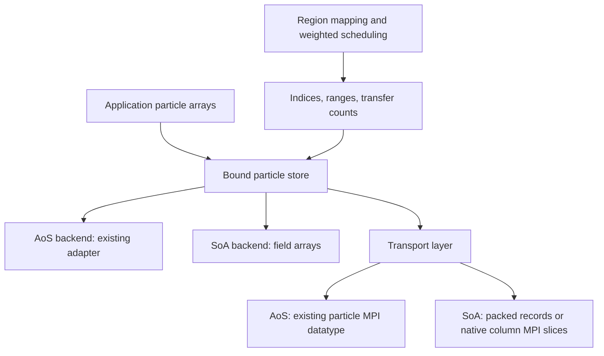

# AoS and SoA Particle Storage Backends

Status: **implemented for Levels 2–4**. Native SoA supports heap-context Level
2/3 and the Level 4p/4s default-context bridge through `oh_particle_storage.h`
and `ohhelp_v2`. AoS remains the default. See the
[SoA usage guide](../usage/soa-particles.md) for the implemented API.

Custom indexed mapping callbacks and separate primary/secondary region columns
remain planned. Level 2/3 use one absolute-node region column; Level 4 uses the
existing packed-grid encoding. Single-particle injection accepts a field-value
pointer vector. Interface sketches below describe the broader target.

The Level 4 bridge retains metadata cursors (bank + index) for legacy loops,
with native column banks for local, sorted, and boundary particles. MPI uses
per-message datatypes over column slices. The local payload is never converted
into an AoS mirror. Bound column addresses remain stable across transfer.

## Decisions

- Support AoS (array of structures) and SoA (structure of arrays) in the same
  library build, selected per context before particle storage is bound.
- **AoS remains the default**, including the default context, raw init bridges,
  and existing C/Fortran entry points. Existing callers need no new option.
- Preserve both the default `S_particle` layout and custom AoS adapters. Keeping
  AoS as the default must not reset a caller's registered adapter.
- Let applications compute directly on their chosen storage. SoA must not
  require a persistent AoS mirror or conversion of all local particles at each
  `transbound` call.
- Separate particle semantics, storage operations, and communication encoding.
  Scheduling continues to use weighted region load and integer particle counts.

This is a host-memory design. GPU/device arrays, AoSoA, variable-length particle
payloads, and concurrent mutation of a bound store are outside the initial
scope. No performance improvement is assumed until measured.

## Why the Existing Adapter Is Not Sufficient

The AoS adapter removes the fixed `S_particle` field layout requirement,
but still describes a contiguous record for each particle:

| Current boundary | AoS assumption that must be isolated |
| --- | --- |
| `include/oh_particle_adapter.h` | Callbacks receive one particle pointer; fields are offsets within a record. |
| `src/c/oh_particle_adapter.c` | Validation requires a nonzero stride and an MPI datatype with zero lower bound and extent equal to that stride. |
| `src/c/oh_particle_buffer.h` | Indexing uses `base + index * stride`; copies use `memmove`; pointer differences recover indices. |
| `src/c/ohhelp2.c` | Movement and receive cursors are particle addresses; MPI receives can write directly into the particle buffer. |
| `src/c/ohhelp3.c` | Position mapping uses record-based access and may modify coordinates. |
| `src/c/ohhelp4_particle.h`, `src/c/ohhelp4p.c`, `src/c/ohhelp4s.c` | Sorting, packed ids, injection, and boundary exchange use record-based storage helpers and communication buffers. |
| `src/fortran/oh_v2.F90`, `src/c/oh_fortran_v2.c` | Particle storage and individual particles cross the interface as `c_ptr` values. |

Changing getters alone cannot make copies, compaction, injection, sorting, or
MPI movement work with separate arrays. A pointer to a SoA descriptor must not
be passed to the current API as if it were a pointer to one particle.

## Responsibility Boundaries



Particle semantics define region/species access and mapping policy. Storage
defines how a logical particle is read, moved, or permuted. Transport defines
how selected particles become MPI messages. A packed communication record does
not make the application's storage AoS.

Backend selection, bound stores, work stores, and transport buffers belong to
`oh_state`. Do not add a process-wide layout flag. Independent heap contexts
may use different backends without sharing mutable storage. Level 4 retains
its existing default-context bridge until its separate context migration is
complete; this proposal does not introduce `oh_context_transbound4`.

## Selection and Compatibility

The selector has `OH_PARTICLE_STORAGE_AOS = 0` and
`OH_PARTICLE_STORAGE_SOA = 1`. Both backends are compiled in; no application
rebuild with a different particle-layout macro is required to select SoA.

Conceptual lifecycle, not compilable API examples:

```text
existing AoS:
  create context -> configure particles -> set adapter (optional)
  -> bind_particles -> bind accounting/geometry -> transbound

explicit SoA:
  create context -> configure particles -> select_storage(SOA)
  -> configure field schema and indexed mapping policy
  -> bind_soa_fields -> bind accounting/geometry -> transbound
```

The existing `oh_context_bind_particles`, adapter setters, particle datatype
setter, and pointer-based particle mapping/injection APIs remain AoS interfaces.
Level 2/3 raw init remains AoS-only; SoA uses heap contexts there. Level 4 init
accepts an explicitly selected SoA backend and leaves its raw particle pointer
slot NULL. New SoA binding and indexed particle APIs are additive. Calling an
AoS-only interface while SoA is selected fails explicitly; it must not silently
switch the backend, convert storage, or return a fabricated particle pointer.
In particular, resetting the existing adapter with `NULL` keeps its current
meaning on AoS and is not a backend-selection mechanism.

Selection and schema changes require an unbound, idle context, following the
current adapter/datatype change rule. Unbinding releases work storage and
invalidates references but retains the selected backend and schema. Switching
to AoS is explicit; destroying and recreating a context restores the default.
Unbinding or switching does not convert or migrate application data.

Initially, all ranks participating in one context must select the same backend
and compatible particle schema. Different contexts may make different choices.
Mixed AoS/SoA ranks within one context are deferred until a common transport
schema can also be registered for arbitrary AoS callback adapters.

## Store and Schema

A bound store describes a logical slot range `[0, capacity)`. It contains the
backend kind, schema, allocation ownership, and either an AoS base pointer or
SoA field bases. Active counts remain in the existing accounting state; binding
capacity does not create particles.

For SoA, a schema lists **every field that must follow the particle**, including
application-only fields such as velocity, charge, weight, and persistent id.
Each field has a stable schema key, scalar type or fixed-size opaque byte item,
item size, and optional semantic role. Binding supplies one contiguous array
per field, all with the same particle capacity. A fixed-size item can contain
several components; separate scalar columns are preferred for coordinate access.
Arbitrary strided sections and ragged arrays are deferred.

Semantic roles identify region, optional species, and optional x/y/z fields.
Region access preserves `oh_particle_region_t` width and the configured
`OH_BIG_SPACE` requirements; narrowing is checked. Built-in coordinate access
uses writable `double` fields. Single-species storage needs no species column.
The implemented schema uses one region column. Distinct primary/secondary
region columns and custom indexed mapping callbacks remain planned. Those
callbacks must retain the `primary_or_secondary` selector and operate on a
store plus index rather than a record pointer.

The initial descriptor path covers numeric fields and fixed-size byte payloads;
it does not copy pointees, serialize process-local pointers, or infer fields
from a C/Fortran type. Unregistered arrays are outside the contract and will
not be reordered or transferred. Applications needing such arrays must either
register them or rebuild them using a registered persistent id.

Ownership follows the existing distinction:

- Borrowed SoA: the context copies descriptors but borrows all field arrays.
  The caller keeps arrays and mapping callback state alive and at fixed
  addresses until unbind. OhHelp may mutate values but never free or grow them.
- Owned SoA: the caller supplies a schema and capacity, without field bases;
  the backend allocates each field and exposes borrowed views for computation.
  Unbind/destroy releases these allocations. Mixed ownership within one store
  is excluded initially.
- Work stores and packed communication buffers are context-owned regardless of
  application-store ownership. Their layouts need not match one another.

Capacity is fixed during binding. The existing capacity helper remains useful
because capacity is measured in particles. Pending injections count against
capacity. Exhaustion must be detected before writes or receives; implicit
reallocation of borrowed storage is forbidden. Empty stores are valid, with
null field bases allowed only for zero capacity. Validate field types, sizes,
required roles, non-overlapping field ranges, and all allocation-size products.
Distinct stores must not alias storage, except explicitly supported views of
the same store.

## Indexed Operations

The shared movement target uses `(store, index)` and `(store, first, count)`,
not a universal `particle_at()` returning a record pointer. Level 2/3 use
indices; Level 4 temporarily retains metadata cursors for its existing loops.
Only the AoS implementation recovers a particle record pointer.

The internal backend contract needs these operations; this is not a proposal
to expose a public callback for every scalar operation:

| Operation | Required semantics |
| --- | --- |
| Read/write region, read species, read/write position | Preserve semantic roles, species base, channel selector, and mapping side effects. |
| Copy particle / copy range | Copy all registered payload fields between compatible stores; overlapping ranges in one store have `memmove` semantics. |
| Gather / reorder / compact | Apply the same source-index selection to every field; in-place permutations must protect unread sources. |
| Allocate/free work store | Use the schema, capacity, and backend-specific ownership rules. |
| Pack / unpack selected ranges | Encode/decode every registered field and preserve selection order; validate destination capacity before writes. |

For a permutation, `dst[i] = old_src[permutation[i]]` applies to every field.
An arbitrary in-place permutation needs scratch storage or a cycle algorithm;
independent forward copies are not sufficient. Range copies must also handle
both upward and downward compaction, as the existing Level 2 loops do.

Dispatch once per bulk operation where possible. Preserve the current AoS
integer-field fast path and direct record copies. SoA implementations can loop
over contiguous fields without invoking a generic callback for each scalar.
Custom indexed mapping is a future extension for policies that descriptors
cannot express. Existing AoS callbacks are not reinterpreted as indexed callbacks.

`pbase`, species partitions, primary/secondary ranges, and transfer counts stay
in particle units. One logical index selects the same particle across every
column. Receive cursors become `(store, offset)` or integer offsets; raw receive
addresses are formed only inside the AoS transport path.

## Communication

The AoS backend preserves the existing MPI datatype and direct communication
path, including custom AoS datatypes. No new wire schema is imposed on existing
AoS callers. The current stride/extent validation remains an AoS requirement,
not a requirement that SoA invent a particle stride.

Level 2/3 SoA transport uses explicit packing into contiguous staging storage:

1. Build the existing weighted schedule and integer send/receive counts.
2. Validate final particle capacity and staging-size arithmetic before changing
   storage. Preserve outgoing particles before compaction can overwrite them.
3. Gather selected particles into schema-defined packed records in transfer
   order. Only particles participating in a transfer need serialization.
4. Exchange staged messages using the existing communication topology.
5. After requests complete, unpack into the scheduled destination slots and
   publish updated counts and primary/secondary ranges.

Local survivors remain SoA. Local movement can use SoA work storage without
serialization. Packed records are transport scratch, not a second authoritative
particle array. Send staging and receive staging remain alive and unmodified
as required until the corresponding requests complete. No callback or public
operation may rebind, resize, or reorder participating storage during exchange.

Initially, packing concatenates fields in schema order without C-struct padding
and transports them as bytes. This assumes matching scalar representation and
endianness across ranks, as with a native byte-copy adapter; it is not a portable
file format or heterogeneous-machine serialization protocol. Unpack uses
alignment-safe copies rather than typed access into possibly unaligned records.
Schema agreement covers ordered field keys, types, sizes, roles, species base,
and encoding version, not array addresses or local capacities.

The Level 2/3 transport uses a contiguous MPI byte datatype for one packed
record, keeping counts/displacements in particle units. Record size must fit
the MPI datatype constructor count, and capacity times record size must fit
the addressable allocation. Receive ranges are checked before posting MPI
requests. Scheduling must never consume byte counts as particle counts.
Zero-count exchanges must be valid without dereferencing null storage.

Backend and schema agreement is checked collectively at a common transfer
preflight point before backend-specific payload communication. Recheck after
reconfiguration. All ranks participate in deciding whether cached agreement
needs revalidation; a local dirty flag must not independently select a
collective call. Schema-field comparison applies to SoA; legacy AoS retains
its existing datatype contract without requiring field registration. A
rank-local validation failure must produce a coordinated failure rather than
letting other ranks enter unmatched MPI calls. Existing AoS setters/binders
remain local calls; do not add collectives to them. The design does not promise
rollback after an MPI runtime failure.

Level 4 uses native column banks and per-message MPI derived datatypes over
their participating slices. Send and receive schedules specify exact particle
counts, so both datatypes describe the same field order and byte lengths.
Pending requests retain their datatypes until completion. Sorting copies back
into the bound columns to keep application addresses stable. This path shares
the schema, capacity, and lifetime contract above; metadata cursor bytes never
enter a particle message. Its performance has not been measured.

## Mapping, Injection, and Level 4

Storage changes must preserve the existing
[particle semantics](particle-adapter.md): negative region skip markers,
reserved `-2` uses, normalized species, packed ids, and the distinction between
position mapping and region-based load accounting. Position mapping can wrap
coordinates in place, so read-only position access is insufficient.

The target includes indexed mapping and injection entry points for SoA. Injection copies one
particle from a compatible source store into the destination injection area
and returns a reference to that **copy**, not to the source. A reference carries
store identity, slot index, and a binding/order generation; it is not a stable
particle identity. Rebind, unbind, transbound, sorting/compaction, or injection
finalization invalidates it. Appending another injection does not invalidate
earlier references if no storage or order changes. Stale and foreign references
must be rejected. Persistent identity is an application payload field.

The pending range remains `[total_parts, total_parts + n_of_injections)`.
Removal updates accounting and marks the injected slot removed. Level 2/3
remapping is additive: remove the old count before remapping an already-counted
copy. Level 4 remapping removes the old count itself, as its AoS API does.
Setting a negative region alone does not undo its count. Finalization through
`set_total_particles_state()` retains its current accounting semantics. The
AoS pointer-returning interfaces keep their current contract through a shim;
SoA must not emulate them by returning a temporary packed-record address.

Level 4p/4s implement packed-grid operations, sorting, boundary-particle
buffers, receive cursors, and temporary particle copies through native column
banks and shared semantic helpers.
Keep `level4_secondary_region_offset`, wide region ids, marker values, and
boundary-plane accounting behind semantic helpers. Mesh/field halo arrays are
separate from particle storage and keep their existing APIs. Level 4 mapping
and remap retain their existing histogram accounting contract.

## Fortran Surface

`ohhelp_v2` exposes the backend selector, interoperable field schema and
reference types, typed column helpers, and indexed mapping/injection operations. C and
Fortran configure the same schema and backend; there is no Fortran-only copy
of storage policy. Existing `type(oh_particle)` and adapter handles continue to
use AoS. The Level 4 `_raw` interfaces accept C-compatible descriptors and
pointer slots for either explicitly selected backend; they do not apply the
legacy Fortran descriptor-index conversion.

Borrowed fields use interoperable, contiguous `target` arrays whose addresses
remain valid for the whole binding. A wrapper must reject non-contiguous
sections rather than retain the address of a temporary. Separate `x(:)`,
`y(:)`, `z(:)` arrays or contiguous columns of `position(capacity, 3)` can be
registered as coordinate fields. `position(3, capacity)` does not provide
contiguous per-coordinate columns under the initial SoA descriptor contract.

Indices and counts at the context boundary remain zero-based offsets in both
languages. For an array with lower bound `lo`, slot `i` is element `lo + i`.
Species base is a separate schema property; Fortran helpers retain the existing
one-based species default. Owned-field views expire at unbind/destroy, and
Fortran must not deallocate storage owned by OhHelp.

## Migration and Acceptance

Each step must leave existing AoS builds and runtime tests working:

1. Add context-local selection and an internal indexed store abstraction with
   AoS as the only enabled backend. Wrap the current adapter and preserve its
   fast paths. Keep the public adapter struct unchanged.
2. Implement the SoA descriptor, borrowed/owned stores, bulk operations, and
   staged transport. Enable Level 2 only after injection, compaction, and both
   primary and secondary movement paths pass equivalent AoS/SoA tests.
3. Enable Level 3 indexed geometry mapping and the C/Fortran integration
   surface, including periodic coordinate mutation and context isolation.
4. Migrate Level 4p/4s sorting and boundary exchange behind the same boundaries.
   Keep their default-context restriction until independently removed.

Until a level is enabled, selecting SoA for that level must fail before
level-specific particle allocation/movement rather than falling back to AoS.
Track this with explicit backend capabilities. Extend
`tests/test_particle_contract_audit.sh` as the
migration lands: existing record-based helpers remain legitimate inside the
AoS backend, while shared scheduling/movement must stop forming particle
addresses. Do not weaken the audit just to accept a partially converted path.

Required acceptance coverage:

- Existing default/custom AoS C/Fortran tests, default-context/raw paths, owned
  and borrowed buffers, and unchanged adapter/MPI datatype behavior.
- SoA unit coverage for complete payload preservation, overlapping copies in
  both directions, cyclic permutations, zero capacity, invalid descriptors,
  overflow, and allocation/unbind lifecycle.
- Multi-rank AoS/SoA equivalence for uniform and non-uniform weights, multiple
  species, empty ranks, primary/secondary transitions, repeated transfers, and
  burst injection/removal/remap. Compare particle ids and all payload fields
  after canonicalizing order, along with counts, `sdid`, `pbase`, and mode.
- Level 3 periodic mapping; Level 4p/4s packed ids, `OH_BIG_SPACE`, sorting,
  boundary exchange, and their distinct injection/marker paths.
- Independent AoS and SoA contexts; stale-reference rejection; collective
  backend/schema mismatch and capacity failure without hangs or out-of-bounds
  writes; Fortran column binding and temporary-array rejection.

Measure AoS regression cost and SoA mapping, local movement, pack/unpack,
communication time, and peak scratch memory separately. Use both mostly-local
and transfer-heavy populations. Removing whole-buffer conversion is a design
requirement; a SoA speedup is an experimental result, not an API guarantee.
